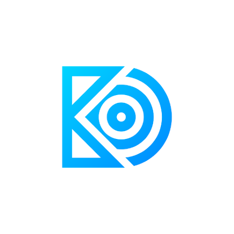
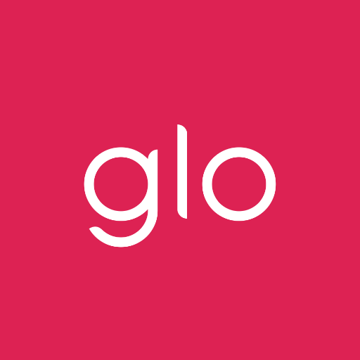

<div align="center">
  

  <h1>Muhammad Sarosh</h1>
  <p><strong>Mobile Engineer · Flutter Products · Connected Devices</strong></p>
  <p>
    I build production mobile products that connect elegant software with real-world devices,
    services, and people.
  </p>

  <p>
    <a href="https://mobileengineersarosh.vercel.app/">Portfolio</a> ·
    <a href="mailto:sarosh.mobileengineer@gmail.com">Email</a> ·
    <a href="https://www.linkedin.com/in/sarosh-tahir">LinkedIn</a> ·
    <a href="https://github.com/sarosh4271">GitHub</a> ·
    <a href="assets/muhammad-sarosh-cv.pdf">Full CV</a> ·
    <a href="assets/muhammad-sarosh-flutter-product-resume.pdf">Product Resume</a> ·
    <a href="assets/muhammad-sarosh-ble-iot-resume.pdf">BLE/IoT Resume</a>
  </p>
</div>

---

## About me

I am a mobile engineer with 5+ years of experience building, scaling, and releasing cross-platform applications. My work spans connected hardware, sports technology, event platforms, student communities, and location-aware consumer products.

My core expertise includes Flutter and Dart, maintainable mobile architecture, BLE/GATT communication, native Android and iOS SDK integration, REST APIs, Firebase, CI/CD, analytics, monetization, and production store delivery.

I enjoy solving the difficult parts of mobile engineering: reliable device communication, native platform interoperability, state and data architecture, polished responsive interfaces, automated delivery, and turning complex product requirements into maintainable systems.

## Career highlights

- **5+ years** building and shipping mobile products.
- **15+ total client projects** delivered across public and confidential work in multiple industries.
- **10+ connected-device applications** within that work, spanning BLE hardware and IoT devices.
- **5 published products** released across the Apple App Store and Google Play.
- Reduced mobile build-to-tester delivery time from approximately **30 minutes to 10 minutes** through release automation.
- Experienced in peer code reviews, troubleshooting, architecture, feature design, technical documentation, and developer mentoring.

## Featured products

| Product | Overview | Availability |
| --- | --- | --- |
|  **BlueDash** | A no-code BLE platform for discovering, monitoring, testing, and controlling custom IoT devices through reusable dashboards. | [Case study](case-studies/bluedash/) · [App Store](https://apps.apple.com/us/app/bluedash/id6447548602) · [Google Play](https://play.google.com/store/apps/details?id=com.sparkleo.blueDashApp&hl=en) |
|  **Plyomat 2.0** | A connected sports-measurement app that transforms live hardware data into plyometric metrics, session analysis, and exports. | [Case study](case-studies/plyomat/) · [App Store](https://apps.apple.com/us/app/plyomat-2-0/id6446678552) · [Google Play](https://play.google.com/store/apps/details?id=net.plyomat.plyomattwo&hl=en) |
|  **UniX — University X** | A student-life platform combining housing, campus community, discovery, transport, study tools, and everyday services. | [App Store](https://apps.apple.com/us/app/unix-university-x/id6740775299) · [Google Play](https://play.google.com/store/apps/details?id=com.unix.com) |
|  **Outdey** | An end-to-end events platform covering discovery, social planning, ticketing, organizer workflows, and QR admission. | [App Store](https://apps.apple.com/us/app/outdey/id6497566952) · [Google Play](https://play.google.com/store/apps/details?id=com.outdey.outdey) |
|  **glo** | A bilingual beauty-discovery experience with maps, filters, ratings, reviews, wishlists, and full Arabic RTL support. | [App Store](https://apps.apple.com/us/app/glo/id6503257805) · [Google Play](https://play.google.com/store/apps/details?id=com.rwnq.rwnq_app) |

## Technical expertise

### Mobile engineering

`Flutter` · `Dart` · `Riverpod` · `Clean Architecture` · `MVVM` · `Responsive UI` · `App Store` · `Google Play`

### BLE, IoT, and native platforms

`BLE/GATT` · `Device Pairing` · `Auto-Reconnection` · `OTA Updates` · `Device Protocols` · `Kotlin` · `Swift` · `Native Android SDKs` · `Native iOS SDKs` · `Platform Channels`

### Backend and product services

`REST APIs` · `Firebase` · `Node.js` · `Google Maps` · `Google Places` · `Push Notifications` · `Payments` · `Subscriptions`

### Delivery, analytics, and growth

`GitHub Actions` · `Xcode Cloud` · `CI/CD` · `Mixpanel` · `Adapty` · `Superwall` · `Analytics Funnels` · `In-App Purchases`

## Professional experience

- **Mobile Engineer — Easy To Use Apps SRL:** Mobile monetization, subscription infrastructure, analytics funnels, and Node.js cloud workflows.

- **Software Engineer — Mobile — Elite IT Team:** Product ownership across consumer Flutter applications, architecture, APIs, maps, payments, multilingual interfaces, automated releases, and peer collaboration.

- **Mobile Application Developer — Sparkleo Technologies:** Connected mobile applications for health devices, sports hardware, RFID readers, LED controllers, and environmental monitors using Flutter, BLE, Kotlin, Swift, and native SDKs.

## About this portfolio

This repository contains my responsive personal portfolio. It is a lightweight static website built with semantic HTML, modern CSS, and vanilla JavaScript.

The website includes:

- Responsive desktop and mobile layouts.
- Professional experience and technical capabilities.
- Separate product and connected-device project paths.
- Ownership, engineering decisions, and observable outcomes for each project.
- In-depth case studies for Outdey, UniX, BlueDash, Plyomat 2.0, and a sanitized private mobile-access integration.
- Direct App Store and Google Play links.
- Technology and tooling showcase.
- Downloadable product and BLE/IoT résumé variants.
- Accessible navigation and reduced-motion support.
- Direct email, LinkedIn, and résumé actions.

## Project structure

```text
.
├── index.html              # Portfolio content and page structure
├── styles.css              # Responsive design and visual system
├── script.js               # Navigation, reveal effects, and analytics hooks
├── case-studies/           # Sanitized technical case studies
└── assets/
    ├── tools/              # Technology logos
    ├── store/              # App Store and Google Play icons
    ├── *.png, *.jpg        # Project screenshots and profile images
    ├── *.webp              # Optimized project assets
    └── muhammad-sarosh-*-resume.pdf
```

## Contact

I am open to mobile engineering roles, selected product work, and technical conversations involving Flutter, connected devices, BLE, native integrations, or mobile product architecture.

- **Email:** [sarosh.mobileengineer@gmail.com](mailto:sarosh.mobileengineer@gmail.com)
- **LinkedIn:** [linkedin.com/in/sarosh-tahir](https://www.linkedin.com/in/sarosh-tahir)
- **GitHub:** [github.com/sarosh4271](https://github.com/sarosh4271)

## License

The website source code is available under the MIT License. Personal photographs, résumé files, branding, written portfolio content, project screenshots, case-study media, and third-party trademarks are excluded; see [LICENSE](LICENSE) for details.

---

<div align="center">
  <strong>Built with care by Muhammad Sarosh.</strong>
</div>
